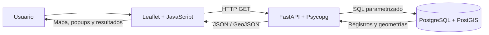

# Laboratorio SIG Web — Programación para SIG

**Portal académico de seis módulos:** [abrir archivos del portal](portal/) · [guía de ejecución](portal/README.md)

| Módulo | Entrar |
|---|---|
| 01 · HTML y CSS | [Lecciones y ejercicios](practicas/01-fundamentos-web/) |
| 02 · JavaScript | [Lecciones y ejercicios](practicas/02-fundamentos-javascript/) |
| 03 · Leaflet básico | [Prácticas cartográficas](practicas/03-leaflet-fundamentos/) |
| 04 · Leaflet avanzado | [Interfaces y herramientas](practicas/04-leaflet-integracion/) |
| 05 · SIG Web/PostGIS | [Proyecto del Quindío](practicas/05-sig-postgis-fastapi/) · [guía académica](docs/visor/00-indice.md) |
| 06 · Proyectos integradores | [Inventario y Geoalerta](proyectos/) |

**Para ver el menú visual:** desde la raíz ejecuta `python -m http.server 5500` y abre `http://127.0.0.1:5500/portal/`. Visitar GitHub muestra la estructura del código, no ejecuta automáticamente la portada HTML. No se ha verificado un despliegue público de GitHub Pages.

---

## Documentación técnica del visor del Quindío

**Comienza aquí:** [Itinerario docente del visor SIG Web](docs/visor/00-indice.md) — presentación, datos, arquitectura, funcionalidades, pruebas y acceso al código.


## Guía principal del proyecto

**Para estudiantes y visitantes:** comenzar por [Guía principal del visor SIG Web](docs/guia-principal-visor.md) y [Modelo de geodatabase vigente](docs/modelo-geodatabase-final.md). La [Etapa 01](docs/etapa-01-geodatabase.md) es histórica (dos tablas), no el modelo final. La guía de [F5](docs/etapa-08-f5-equipamientos.md) ya está disponible.

**Proyecto docente · Ingeniería Topográfica y Geomática · Programación para SIG**

Aplicación SIG Web que consulta una geodatabase PostgreSQL/PostGIS mediante una API Python/FastAPI y representa los resultados en un frontend HTML, CSS, JavaScript y Leaflet. El énfasis didáctico es comprobar el recorrido **evento del usuario → HTTP → FastAPI → SQL/PostGIS → JSON/GeoJSON → representación en el visor**.

## Estado funcional (1 de noviembre de 2026)

**F1–F5 implementadas.** Las funcionalidades se han probado en el equipo docente; las pruebas registradas son verificaciones funcionales puntuales, no una auditoría automatizada completa ni mediciones de rendimiento. La versión de F4 con búsqueda de sedes de salud fue probada en el navegador, con respuesta HTTP 200, marcadores y listado ordenado.

| ID | Funcionalidad | Activación | Endpoint | Respuesta |
|---|---|---|---|---|
| F1 | Cargar los 12 municipios del Quindío | Al abrir el visor | `GET /municipios` | GeoJSON FeatureCollection |
| F2 | Consultar detalle y superficie geodésica | Botón del popup municipal | `GET /municipios/{codigo}` | JSON |
| F3 | Identificar municipios que cubren un punto | Modo identificación + clic | `GET /consultas/ubicacion?lon=...&lat=...` | GeoJSON FeatureCollection |
| F4 | Buscar sedes de salud próximas a un punto | Radio en metros + modo F4 + clic | `GET /consultas/proximidad?lon=...&lat=...&radio_m=...` | GeoJSON FeatureCollection de puntos |
| F5 | Mostrar equipamientos por municipio y categoría | Selección de municipio y categoría | `GET /equipamientos/municipio/{codigo}?tipo=1|2` | GeoJSON FeatureCollection de puntos |

Para la especificación completa, respuestas y pruebas véase [Funcionalidades](docs/funcionalidades.md). La nueva F4 dispone de [guía de implementación y verificación](docs/etapa-07-f4-proximidad-salud.md).

## Datos y modelo

Base local: `programacion_sig`. Se emplean **cuatro tablas principales**, sin contar las tablas de preparación (*staging*):

| Tabla | Registros validados en la práctica | Función |
|---|---:|---|
| `public.departamento` | 1 | Quindío (63) |
| `public.municipio` | 12 | Límites municipales, `geometry(MultiPolygon,4326)` |
| `public.tipo_equipamiento` | 2 | Educativo (`id_tipo=1`) y Salud (`id_tipo=2`) |
| `public.equipamiento` | 645 | 418 educativos y 227 de salud; `geometry(Point,4326)` |

Relaciones: `departamento` **1:N** `municipio`; `municipio` **1:N** `equipamiento`; `tipo_equipamiento` **1:N** `equipamiento`.

**Fuentes y trazabilidad:** cartografía municipal DANE/DIVIPOLA MGN 2025; sedes educativas DANE/SISE 2026; sedes de prestadores de salud SISPRO/REPS. En la carga de salud se revisaron 228 registros de origen: 227 se integraron y uno se excluyó por discrepancia entre municipio declarado y localización del punto. Los datos originales y la geodatabase poblada **no están incluidos en este repositorio**; las cifras anteriores corresponden al equipo docente y no deben interpretarse como reproducción automática al clonar el proyecto.

El campo `estado` de los equipamientos es un atributo textual (actualmente «Sin verificar»), **no una tabla independiente**.

## Arquitectura



El navegador no accede directamente a PostgreSQL. Las credenciales se mantienen en un archivo `.env` local excluido del control de versiones. `pgAdmin 4` es una interfaz de administración, no un componente necesario para atender las peticiones del geovisor; QGIS es una herramienta de preparación y revisión cartográfica.

## Puesta en marcha en el equipo configurado

Se requiere Python con las dependencias de `backend/main.py` (`fastapi`, `uvicorn`, `psycopg`, `python-dotenv`), PostgreSQL con PostGIS, las tablas y los datos cargados en la base local, y un archivo `.env` con `DB_HOST`, `DB_PORT`, `DB_NAME`, `DB_USER` y `DB_PASSWORD`.

Desde la raíz del proyecto, en PowerShell y con el entorno virtual ya preparado:

```powershell
.\.venv\Scripts\python.exe -m uvicorn backend.main:app --reload
```

Abrir `http://127.0.0.1:8000/`. El estado del servidor se comprueba en `GET /salud`. Si el navegador conserva código antiguo, actualizar con las herramientas de desarrollador abiertas y **Disable cache**, seguido de una recarga completa.

**No se afirma reproducibilidad autónoma desde GitHub:** clonar el repositorio no crea ni puebla por sí solo PostgreSQL/PostGIS. Para un entorno nuevo deben instalarse las herramientas, crear el esquema y cargar datos con procedencia adecuada; los scripts presentes en `sql/` y las guías históricas describen partes del proceso.

## F4 actual — distancia a sedes de salud

La consulta filtra `public.equipamiento` con `e.id_tipo = 2`, aplica `ST_DWithin(e.geom::geography, punto::geography, radio_m)`, y calcula `ST_Distance` en metros. La respuesta es **GeoJSON con puntos, identificadores, nombre, dirección, código de habilitación y distancia**; Leaflet dibuja los marcadores y un círculo orientativo.

El radio inicial de la interfaz es **2.000 m**; el usuario puede indicar otro valor positivo hasta **50.000 m** antes de activar el modo. Son distancias geodésicas entre puntos, **no** distancias viales, tiempos de desplazamiento ni pruebas de capacidad o disponibilidad asistencial.

### Evidencia funcional observada

- Prueba por PowerShell con `lon=-75.70909`, `lat=4.53458`, `radio_m=10000`: `FeatureCollection` con **209** sedes.
- Prueba posterior en navegador desde un punto distinto, aproximadamente `lon=-75.65484`, `lat=4.55255`, `radio_m=10000`: **204** sedes, petición HTTP **200**, marcadores y distancias en el panel.
- Durante la integración se identificó una incompatibilidad de caché: un `app.js` antiguo esperaba una lista JSON de municipios. Tras recargar sin caché, el frontend procesó correctamente la nueva respuesta GeoJSON.

Las cifras son conteos dependientes del punto, radio y versión de los datos; no constituyen métricas de rendimiento. Ver [guía F4](docs/etapa-07-f4-proximidad-salud.md).

## Ejercicios Leaflet incorporados

El [Módulo 03 — Fundamentos Leaflet](practicas/03-leaflet-fundamentos/) incorpora nueve prácticas independientes (mapa base, capas, controles, métodos, eventos, estado, geometrías y GeoJSON), con [guía de ejecución y límites de comprobación](practicas/03-leaflet-fundamentos/README.md). Se accede desde el portal docente. Son adaptaciones de los ejemplos iniciales; su verificación final en navegador sigue pendiente.

## Portal docente — Fase 1

Se incorporó [Laboratorio SIG Web](portal/index.html) como portada de navegación. El [manual del portal](portal/README.md) explica su ejecución con un servidor estático local y la diferencia entre ejercicios pendientes y aplicaciones accesibles. La práctica PostGIS sigue funcionando en su ubicación original (`backend/` y `frontend/`) y **no se movió ni modificó**.

Desde la raíz del repositorio, se puede abrir el portal mediante `python -m http.server 5500` y visitar `http://127.0.0.1:5500/portal/`. El enlace de PostGIS requiere el servidor FastAPI en `http://127.0.0.1:8000/` y su geodatabase local.

## Organización del repositorio

- `portal/`: portada del laboratorio y catálogo de prácticas; no reemplaza el SIG existente.\n- `backend/main.py`: endpoints F1–F5 y conexión a PostGIS.
- `frontend/index.html`, `frontend/style.css`, `frontend/app.js`: interfaz y lógica de Leaflet.
- `docs/`: arquitectura, diseño, etapas y [especificación de funcionalidades](docs/funcionalidades.md).
- `sql/`: scripts históricos de creación y verificación; revisar precondiciones antes de ejecutarlos.
- `proyectos/`: desarrollos asociados.

### Guías

[Arquitectura](docs/arquitectura.md) · [Etapa 03 — primer backend FastAPI](docs/etapa-03-primer-backend-fastapi.md) · [Hoja de ruta actualizada](docs/hoja-de-ruta.md) · [Modelo de cuatro tablas](docs/modelo-ampliado-cuatro-tablas.md) · [F1](docs/etapa-04-f1-leaflet.md) · [F2](docs/etapa-05-f2-detalle-municipal.md) · [F3](docs/etapa-06-f3-identificacion-espacial.md) · [F4 — Salud](docs/etapa-07-f4-proximidad-salud.md) · [Funcionalidades y pruebas](docs/funcionalidades.md).

**Alcance documental:** algunas guías tempranas recogen el diseño incremental y pueden describir estados anteriores. Este README, la especificación funcional actualizada y el código vigente prevalecen para el comportamiento de F1–F5.

## Módulo 04 — interfaces y herramientas Leaflet

Se incorporaron [dos prácticas autónomas](practicas/04-leaflet-integracion/): barra lateral con búsqueda y dibujo mediante Leaflet.draw. Se trata de adaptaciones docentes, no copias literales de los ejercicios originales. El ruteo externo se mantiene pendiente porque el material de origen contiene una clave incrustada que debe revocarse y sustituirse antes de una publicación segura. No se modificó el backend PostGIS.

## Módulos de fundamentos web y JavaScript

- [Fundamentos HTML y CSS](practicas/01-fundamentos-web/): siete lecciones y ejercicio de cotización con CSS externo.
- [Fundamentos JavaScript](practicas/02-fundamentos-javascript/): seis ejemplos reconstruidos de sintaxis y lógica.

Son adaptaciones docentes; el RAR de JavaScript no permitió verificar y trasladar fielmente todos los originales. Se conservaron los archivos fuente aportados al trabajo sin publicar datos personales ni direcciones locales de imágenes. Se requiere completar la revisión de otras versiones y la prueba en navegador.

## Apartado del visor SIG Web desarrollado en clase

El [apartado del visor PostGIS/FastAPI](practicas/05-sig-postgis-fastapi/) reúne las funcionalidades F1–F5, la arquitectura, las rutas de consulta, instrucciones de ejecución y enlaces al código y las guías. Se accede desde el **Laboratorio SIG Web**. Es una página de orientación: el código sigue en `backend/` y `frontend/`, sin migración ni duplicación de la aplicación.
