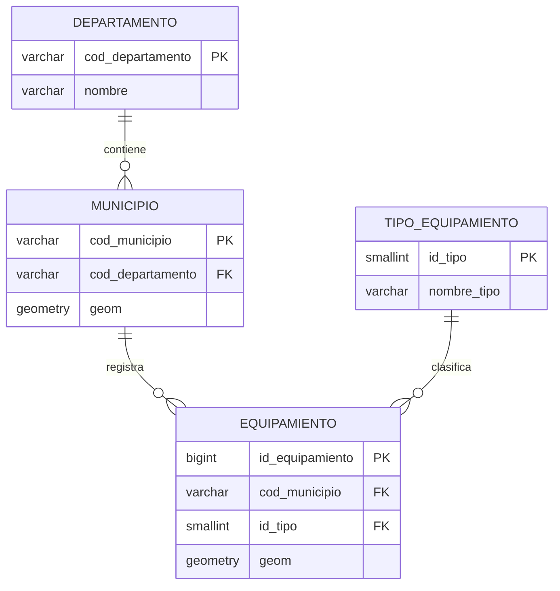

# Guía principal del visor SIG Web del Quindío

**Referencia vigente del ejercicio integrador · 2 de noviembre de 2026**

Este documento es la **puerta de entrada** para estudiantes y lectores. Las guías de etapas muestran cómo evolucionó el proyecto; este documento describe lo que hace **actualmente** el código publicado.

## 1. ¿Qué construimos?

Una aplicación que visualiza los 12 municipios del Quindío y consulta 645 equipamientos georreferenciados. El usuario interactúa con Leaflet; JavaScript envía solicitudes HTTP a FastAPI; Python se comunica con PostgreSQL mediante Psycopg; PostGIS almacena los datos y ejecuta las operaciones geográficas. Las respuestas regresan como JSON o GeoJSON.

**No se necesita saber programar todo de memoria.** Lo importante es comprender: evento → solicitud → consulta → respuesta → representación.

## 2. Dónde está cada parte

| Recurso | Archivo o ruta | Qué encontrarás |
|---|---|---|
| Entrada docente | [Apartado del visor](../practicas/05-sig-postgis-fastapi/) | Funcionalidades, arquitectura y accesos |
| Pantalla del visor | [`frontend/index.html`](../frontend/index.html) | Controles y estructura HTML |
| Estilos | [`frontend/style.css`](../frontend/style.css) | Presentación visual |
| Interacciones | [`frontend/app.js`](../frontend/app.js) | Eventos, `fetch()`, GeoJSON y Leaflet |
| API | [`backend/main.py`](../backend/main.py) | Endpoints, validaciones, Psycopg y SQL |
| Geodatabase | [Modelo de referencia](modelo-geodatabase-final.md) | Cuatro tablas y relaciones |
| API y pruebas | [Funcionalidades](funcionalidades.md) | Contrato F1–F5 |
| Evolución docente | [Hoja de ruta](hoja-de-ruta.md) | Secuencia de etapas documentadas |
| SQL inicial | [`sql/`](../sql/) | **Solo** creación y auditoría histórica de municipios |

## 3. Modelo de datos vigente



Los tipos del diagrama son **orientativos**, excepto las definiciones que sí constan en scripts versionados. La tabla `departamento` no tiene geometría; `municipio.geom` es `MultiPolygon,4326` y `equipamiento.geom` es `Point,4326` según la implementación utilizada. El catálogo tiene 2 categorías: Educativo (1) y Salud (2). La base docente registra 1 departamento, 12 municipios y 645 equipamientos (418 educativos, 227 de salud).

**Límite de verificación:** en GitHub no hay un script de creación final de `tipo_equipamiento` y `equipamiento`, ni una exportación de `pg_catalog` o `information_schema` de esas tablas. Por tanto, sus restricciones, tipos y valores por defecto deben auditarse en la base local antes de publicar un DDL final reproducible. No se deben inventar restricciones ni considerar este diagrama una exportación de PostgreSQL.

## 4. Funcionalidades

| Función | Pregunta que resuelve | Consulta |
|---|---|---|
| **F1** | ¿Cuáles son los municipios? | `GET /municipios` → polígonos GeoJSON |
| **F2** | ¿Cuál es la superficie calculada de este municipio? | `GET /municipios/{codigo}` → JSON y `ST_Area` |
| **F3** | ¿Qué municipio cubre este punto? | `GET /consultas/ubicacion?lon=...&lat=...` → `ST_Covers` |
| **F4** | ¿Qué sedes de salud están dentro de este radio? | `GET /consultas/proximidad?lon=...&lat=...&radio_m=...` → `ST_DWithin` y `ST_Distance` |
| **F5** | ¿Qué sedes educativas o de salud están registradas en este municipio? | `GET /equipamientos/municipio/{codigo}?tipo=1|2` → filtro por atributos |

**Importante:** F3 utiliza contención espacial incluyendo límites; F4 calcula distancias geodésicas directas en metros; F5 filtra por código administrativo, **no** comprueba si las coordenadas del punto caen dentro del polígono municipal.

## 5. Ejecutar en el computador docente

Prerequisitos: PostgreSQL/PostGIS local, base `programacion_sig` poblada, Python con FastAPI, Uvicorn, Psycopg y python-dotenv, y variables privadas en `.env` (no se suben al repositorio).

Desde la raíz del proyecto, con el entorno `.venv` preparado:

```powershell
.\.venv\Scripts\python.exe -m uvicorn backend.main:app --reload
```

- Visor: `http://127.0.0.1:8000/`
- API interactiva: `http://127.0.0.1:8000/docs`
- Comprobación del servidor: `http://127.0.0.1:8000/salud`.

La ruta `/salud` solo comprueba FastAPI, **no** que PostgreSQL esté conectado. Para verificar conexión consultar `/municipios`. Las rutas `127.0.0.1` son locales: el visitante externo no puede usar la base docente desde GitHub Pages.

## 6. Cómo comprobar que las consultas son reales

1. Abrir el visor y las herramientas de desarrollador del navegador → **Network**.
2. Realizar una acción (por ejemplo, F4: radio, activar modo y clic).
3. Identificar la petición HTTP, sus parámetros y el código de estado.
4. Leer la respuesta JSON/GeoJSON.
5. Localizar la ruta correspondiente en `backend/main.py` y el SQL ejecutado.
6. Comprobar que Leaflet representa ese resultado, no un conjunto fijo incorporado al JavaScript.

La visualización no demuestra por sí sola validez científica de los datos. Las verificaciones manuales registradas corresponden al equipo docente, **no** a un conjunto de pruebas automatizadas completas ni a un despliegue público.

## 7. Alcances y advertencias

- Los equipamientos tienen el campo `estado` con el valor **«Sin verificar»**: no se comprobó su funcionamiento en campo.
- Las sedes de Salud son sedes de prestadores, **no necesariamente hospitales ni servicios de urgencias**.
- El radio de F4 no equivale a distancia vial ni a tiempo de acceso.
- Los polígonos municipales proceden de la versión DANE/DIVIPOLA MGN 2025 utilizada en la práctica; no se ha documentado una auditoría topológica completa.
- Una relación administrativa de F5 no garantiza contención espacial. Se detectó y excluyó una inconsistencia en los datos de salud.
- La geodatabase poblada y los insumos fuente completos **no están publicados**; el repositorio no se puede ejecutar autónomamente solo con `git clone`.

## 8. Lectura sugerida

Primero [arquitectura](arquitectura.md), después [modelo final](modelo-geodatabase-final.md) y [funcionalidades](funcionalidades.md). Para reconstruir el proceso pedagógico, comenzar por [Etapa 01](etapa-01-geodatabase.md), continuar por [Etapa 02](etapa-02-carga-municipios.md), [Etapa 03](etapa-03-primer-backend-fastapi.md) y seguir hasta F4. F5 tiene una [guía específica](etapa-08-f5-equipamientos.md).
