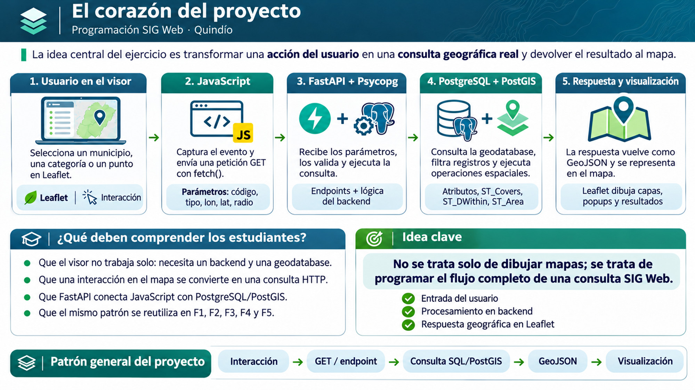

# 01 · Presentación del ejercicio integrador

[← Índice](00-indice.md) · [Siguiente: datos y geodatabase →](02-datos-geodatabase.md)

## Lámina de orientación

> **Lectura de la figura.** La lámina resume el recorrido completo de una consulta; su diagrama es conceptual y los detalles ejecutables se encuentran en el código fuente.

## ¿Qué problema resolvemos?

Queremos pasar de **ver entidades en un mapa** a **consultar información geográfica que reside en una base de datos**. El usuario puede explorar los municipios del Quindío, consultar su superficie, identificar un municipio mediante coordenadas y visualizar equipamientos educativos o sedes de salud.

## ¿Qué construimos?

Una aplicación SIG Web con tres componentes: **Leaflet y JavaScript** (interfaz), **FastAPI y Psycopg** (API y conexión) y **PostgreSQL/PostGIS** (persistencia y análisis espacial). El navegador no se conecta directamente a PostgreSQL.

## Qué aprenderás

- Distinguir una interacción cartográfica de una consulta a la base de datos.
- Leer una petición HTTP, su endpoint y sus parámetros.
- Entender por qué ciertas operaciones se hacen en PostGIS y no en el navegador.
- Interpretar respuestas JSON/GeoJSON y dibujarlas con Leaflet.
- Verificar resultados y reconocer limitaciones geométricas y de los datos.

## Cinco funcionalidades, un patrón común

| Función | Pregunta | Núcleo técnico |
|---|---|---|
| F1 | ¿Qué municipios existen? | `GET /municipios` · `ST_AsGeoJSON` |
| F2 | ¿Qué superficie tiene este municipio según la geometría cargada? | `GET /municipios/{codigo}` · `ST_Area` |
| F3 | ¿Qué municipio cubre un punto? | `GET /consultas/ubicacion` · `ST_Covers` |
| F4 | ¿Qué sedes de salud se encuentran dentro de un radio? | `GET /consultas/proximidad` · `ST_DWithin` |
| F5 | ¿Qué equipamientos están registrados administrativamente en un municipio? | `GET /equipamientos/municipio/{codigo}` · filtro SQL |

**Precisión:** F4 mide distancias geodésicas directas, no recorridos por la red vial. F5 consulta códigos administrativos, no valida la inclusión de cada punto en el polígono.

## Cómo está organizado el material

La explicación conceptual está aquí; las [funcionalidades documentadas](../funcionalidades.md) muestran sus contratos y pruebas; el [código vigente](../../backend/main.py) y el [frontend](../../frontend/app.js) permiten comprobar cada afirmación. Las [etapas históricas](../hoja-de-ruta.md) muestran la secuencia real del trabajo.

**Ejercicio de lectura:** abre el [visor JavaScript](../../frontend/app.js) y localiza una llamada a `fetch()`. Después identifica la ruta correspondiente en [FastAPI](../../backend/main.py). No necesitas entender aún todos los detalles: observa la relación entre ambas partes.
