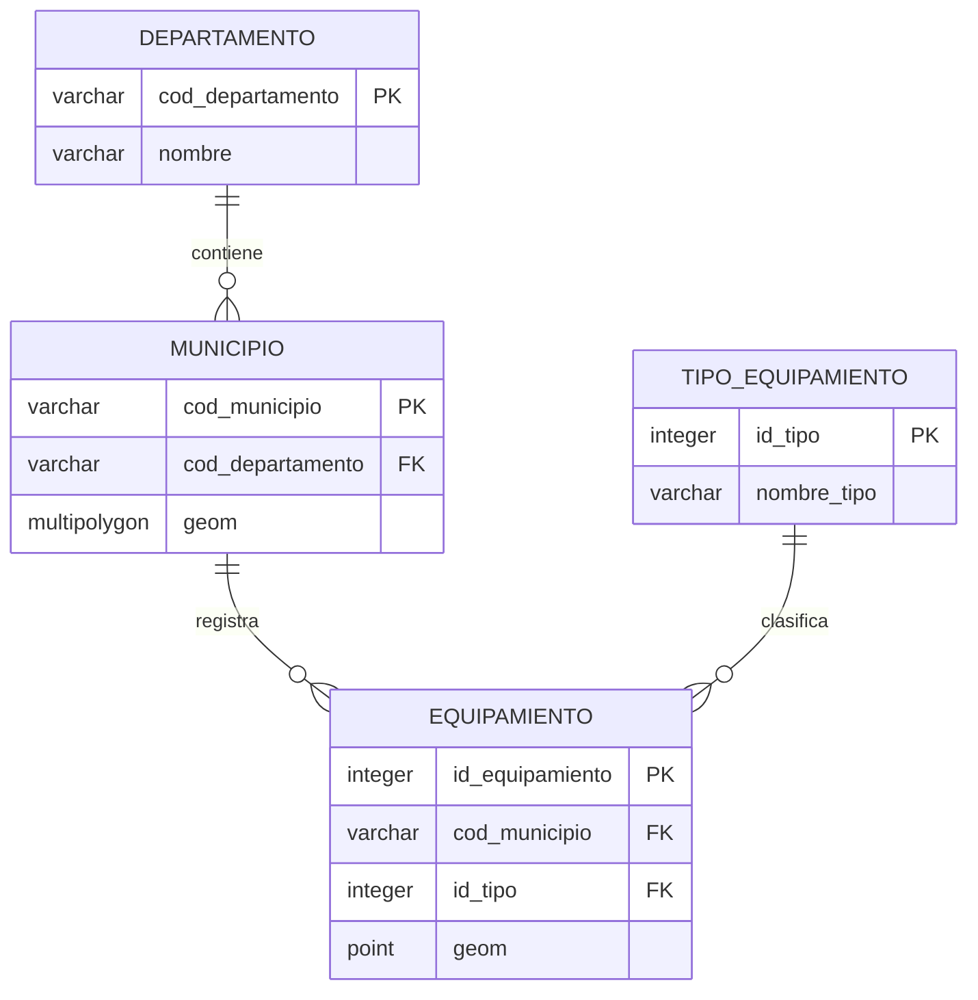

# 02 · Datos y geodatabase

[← Presentación](01-presentacion.md) · [Índice](00-indice.md) · [Arquitectura →](03-arquitectura.md)

## ¿De dónde vienen los datos?

La instalación docente integra tres conjuntos de fuentes administrativas:

| Información | Fuente registrada en el proyecto | Incorporados |
|---|---|---:|
| Límites municipales del Quindío | DANE / DIVIPOLA / MGN 2025 | 12 municipios |
| Sedes educativas | DANE / SISE 2026 | 418 puntos |
| Sedes de prestadores de salud | SISPRO / REPS | 227 puntos |

Durante la validación de salud se excluyó **uno de 228 registros candidatos** por discrepancia entre municipio declarado y localización del punto. Estos conteos corresponden al conjunto **cargado en la instalación docente**, no a un censo exhaustivo ni a un servicio de actualización automática.

## ¿Qué se hizo con los datos?

**Obtención → selección territorial → revisión geométrica y de atributos → adaptación a EPSG:4326 → carga en PostGIS → consulta por FastAPI.**

`ST_SetSRID` declara la referencia espacial; no modifica coordenadas. Si los datos vienen de otro CRS, la transformación debe efectuarla `ST_Transform` o un proceso equivalente correctamente configurado. La validez individual de las geometrías no demuestra ausencia de solapamientos entre polígonos.

## ¿Por qué cuatro tablas?

- `departamento`: referencia administrativa; **no** almacena geometría.
- `municipio`: 12 límites `MultiPolygon` en EPSG:4326.
- `tipo_equipamiento`: dos categorías, Educativo (1) y Salud (2).
- `equipamiento`: 645 puntos `Point` en EPSG:4326, con referencias al municipio y a la categoría.

Las relaciones 1:N están implementadas mediante **tres claves foráneas**. También se comprobaron **cuatro claves primarias**, una restricción de unicidad en `nombre_tipo`, controles de validez geométrica y dos índices GiST espaciales. **El campo `id_equipamiento` es INTEGER**, no BIGINT.

## Cómo se asegura la integridad

La clave primaria impide duplicar identificadores dentro de una tabla; la clave foránea impide referenciar una fila administrativa inexistente; las restricciones de geometría rechazan geometrías inválidas o vacías. **No garantizan por sí solas que un punto esté dentro del municipio asociado**.

En la base docente se registraron 18 columnas, 17 restricciones y 7 índices. La [referencia del modelo vigente](../modelo-geodatabase-final.md) documenta qué se verificó y qué requiere una exportación completa del esquema.

## Qué datos NO debemos confundir

- **Registros cargados** no significa **todos los establecimientos existentes**.
- **Ubicación almacenada** no significa **posición comprobada en campo**.
- **Sede de prestador de salud** no significa necesariamente **hospital o urgencias**.
- **Código municipal asociado** no significa necesariamente **contención espacial verificada**.

## Consulta el material técnico

[Diccionario y modelo](../modelo-geodatabase-final.md) · [Etapa inicial de dos tablas](../etapa-01-geodatabase.md) · [Carga municipal](../etapa-02-carga-municipios.md) · [Consultas F1–F5](../funcionalidades.md)

La Etapa 01 describe deliberadamente el **primer modelo de dos tablas**. No debe utilizarse como definición de la geodatabase final.
