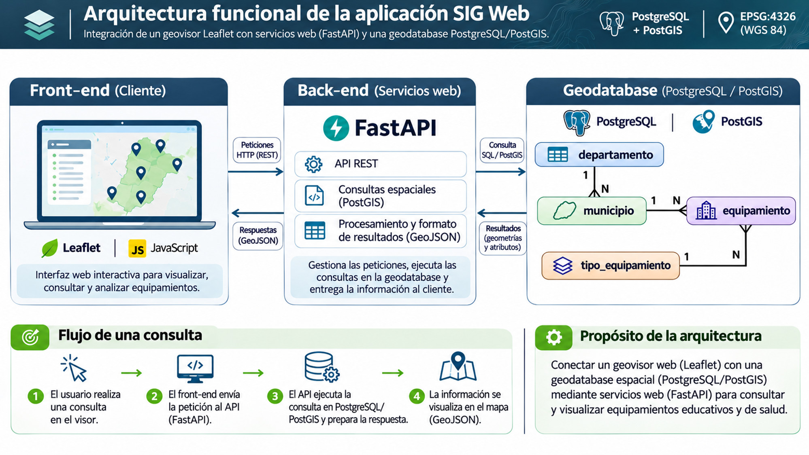
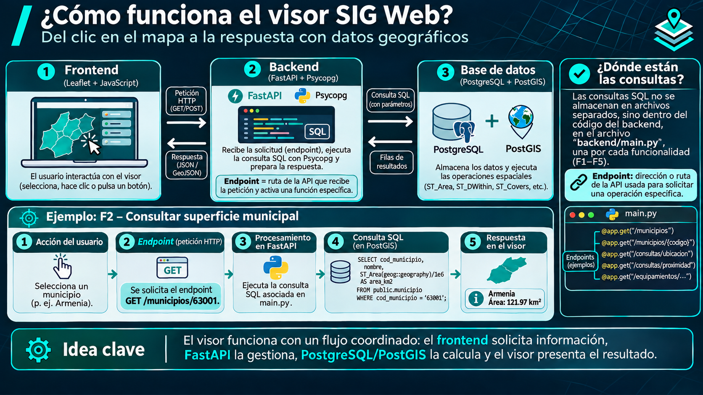
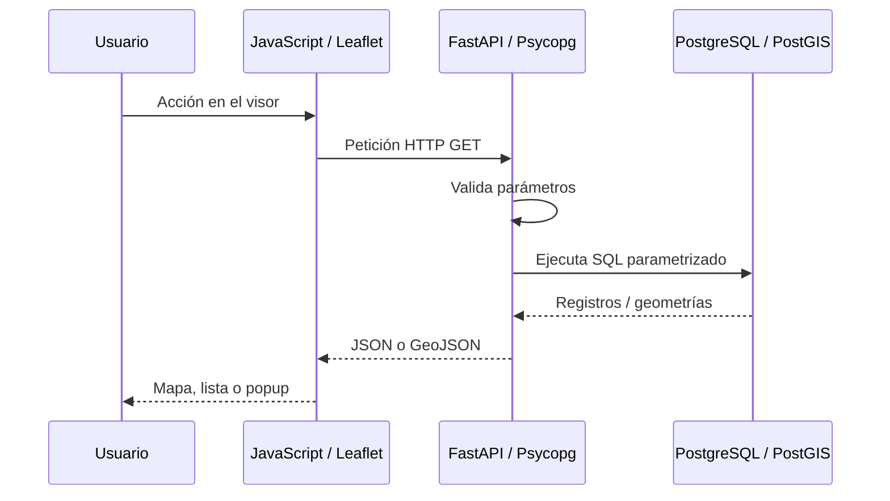

# 03 · Arquitectura funcional de la aplicación

[← Datos y geodatabase](02-datos-geodatabase.md) · [Índice](00-indice.md) · [Funcionalidades F1–F5 →](../funcionalidades.md)

## Lámina de orientación



> **Lectura de la figura.** La figura es una síntesis; las consultas se ejecutan en PostgreSQL/PostGIS mediante el backend, no directamente desde Leaflet.


## Del clic a la respuesta: endpoints y ejecución de consultas



**Endpoint**: combinación de una ruta de la API y un método HTTP que permite solicitar una operación específica del backend. Por ejemplo, `GET /municipios/63001` solicita el detalle del municipio cuyo código es `63001`. En `backend/main.py`, FastAPI vincula esa ruta con la función decorada mediante `@app.get("/municipios/{codigo}")`.

La consulta SQL **está definida en el código Python del backend**, pero **se ejecuta en PostgreSQL/PostGIS** cuando la función la envía mediante Psycopg, por ejemplo con `cursor.execute(sql, (codigo,))`. La respuesta de F2 es **JSON** con la superficie geodésica; otras funcionalidades devuelven **GeoJSON** cuando necesitan transferir geometrías.

> **Alcance de la lámina:** el valor de superficie que aparece junto a Armenia es ilustrativo y no está verificado contra la geodatabase del proyecto. Los ejemplos abreviados de SQL y rutas permiten explicar el mecanismo, pero para reproducir los cálculos deben consultarse las sentencias parametrizadas completas de `backend/main.py`. El verbo `POST` aparece en la figura como posibilidad general de HTTP; **las cinco funcionalidades actuales del visor utilizan `GET`**.

## Los tres componentes

| Componente | Tecnología | Responsabilidad |
|---|---|---|
| **Frontend** | HTML, CSS, JavaScript, Leaflet | Recoger acciones, mostrar el mapa y presentar respuestas |
| **Backend** | Python, FastAPI, Psycopg | Validar solicitudes, ejecutar consultas y devolver resultados |
| **Geodatabase** | PostgreSQL, PostGIS | Mantener datos, relaciones y operaciones geoespaciales |

`pgAdmin` sirve para administrar o inspeccionar PostgreSQL, pero **no participa en la solicitud normal del usuario**. `GeoJSON` es un formato de intercambio de entidades y geometrías, no una base de datos ni un servidor.

## De un clic a un resultado



### Un ejemplo: F3, identificación espacial

1. Se activa **Identificar ubicación** y se hace clic en el mapa.
2. Leaflet entrega las coordenadas. JavaScript envía `lon` y `lat`.
3. FastAPI comprueba que sean números dentro de sus intervalos.
4. PostGIS compara el punto con los municipios mediante `ST_Covers`.
5. FastAPI genera una `FeatureCollection` y Leaflet resalta las coincidencias.

La solicitud usa la ruta:

```text
GET /consultas/ubicacion?lon=-75.7&lat=4.5
```

Las coordenadas son **solo un ejemplo de formato**, no una garantía de que ese punto se encuentre dentro de un municipio concreto. PostGIS recibe `ST_MakePoint(lon, lat)` en ese orden; el manejo usual de coordenadas de Leaflet al crear marcadores es `[lat, lon]`.

## Código fuente: dónde mirar

- [Frontend `app.js`](../../frontend/app.js): eventos, peticiones con `fetch()` y dibujo con Leaflet.
- [Backend `main.py`](../../backend/main.py): rutas `@app.get`, validación, `cursor.execute(...)` y composición de JSON/GeoJSON.
- [Contrato funcional vigente](../funcionalidades.md): entradas, salidas y pruebas de F1–F5.

El backend usa parámetros `%s` suministrados aparte por Psycopg. **Nunca** concatenar directamente el texto proporcionado por el usuario en una sentencia SQL.

## Un criterio para comprobar que la aplicación realmente consulta la base

Abrir las herramientas de desarrollador del navegador, pestaña **Network**, activar una funcionalidad y observar la petición HTTP y su respuesta. Comparar la ruta con el backend y verificar que la consulta corresponda con el resultado mostrado. Una captura del mapa, por sí sola, no demuestra que la petición haya llegado a PostGIS.

## Límites de interpretación

F2 calcula el área geodésica a partir de la geometría almacenada; no recupera automáticamente una superficie oficial. F4 usa `geography` para calcular distancias geodésicas en metros, no rutas de transporte. F5 utiliza un filtro por atributos, no un predicado de contención espacial. Estas diferencias son esenciales para interpretar correctamente la información.

[Continuar con F1–F5](../funcionalidades.md) · [Modelo físico](../modelo-geodatabase-final.md)
