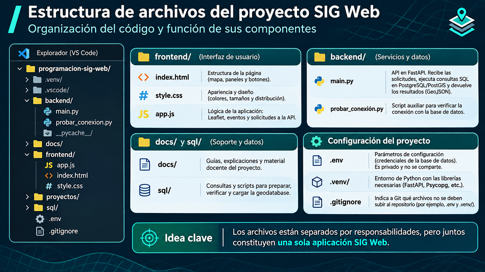

# 04 · Plataformas y preparación del entorno

[← Arquitectura](03-arquitectura.md) · [Índice del visor](00-indice.md) · [Siguiente: F1–F5](05-funcionalidades/)

## ¿Qué herramientas necesitamos?


La figura muestra **qué responsabilidad cumple cada herramienta**, pero no significa que todas intervengan en cada petición del usuario.

| Herramienta | Responsabilidad en el ejercicio |
|---|---|
| PostgreSQL + PostGIS | Almacenar tablas y geometrías; ejecutar consultas SQL y funciones geoespaciales |
| pgAdmin 4 | Crear, inspeccionar y administrar la base de datos; no interviene cuando un usuario consulta el visor |
| QGIS | Preparar, visualizar y revisar los datos antes de la carga |
| Python + FastAPI + Psycopg | Publicar endpoints HTTP y consultar PostgreSQL desde el backend |
| HTML + CSS + JavaScript + Leaflet | Mostrar el visor, recoger interacciones y representar JSON/GeoJSON |

## ¿Dónde se encuentra el código?



La lámina representa la **organización local observada en VS Code**. No es un listado completo del repositorio de GitHub: las carpetas locales y los archivos publicados pueden diferir.

| Archivo o carpeta | Para qué sirve |
|---|---|
| `frontend/index.html` | Organiza los elementos visibles: mapa, paneles y botones |
| `frontend/style.css` | Define la apariencia y distribución de la interfaz |
| `frontend/app.js` | Gestiona Leaflet, los eventos y las peticiones HTTP |
| `backend/main.py` | Publica la API FastAPI, conecta mediante Psycopg y consulta PostgreSQL/PostGIS |
| `backend/probar_conexion.py` (local) | Script auxiliar que solicita la contraseña con `getpass`, conecta a `programacion_sig` y ejecuta `SELECT COUNT(*) FROM public.municipio` |
| `docs/` | Conserva las lecciones y explicaciones del proyecto |
| `sql/` | Contiene scripts SQL de preparación y comprobación de la geodatabase |
| `.env` y `.venv/` (locales) | Configuración privada de conexión y entorno de dependencias Python |
| `.gitignore` | Define qué archivos no deben incorporarse al control de versiones |

**Distinción importante:** `probar_conexion.py` verifica una conexión directa a PostgreSQL y una consulta de recuento; **no prueba que PostGIS funcione espacialmente ni interviene en las solicitudes normales del visor**. El archivo que atiende esas solicitudes es `backend/main.py`. El script auxiliar se ha comprobado a partir del contenido compartido durante la clase, no de una versión publicada en el repositorio.

**Seguridad:** `.env` puede contener credenciales y no debe publicarse. `.venv/` tampoco necesita subirse a GitHub. La imagen ilustra archivos locales, no una invitación a incorporarlos al repositorio.

## Qué sucede cuando usamos el visor

Una vez preparados y cargados los datos, el circuito normal no pasa por QGIS ni por pgAdmin: **Leaflet/JavaScript → FastAPI/Psycopg → PostgreSQL/PostGIS → respuesta JSON/GeoJSON → Leaflet**.

No todos los endpoints devuelven GeoJSON: por ejemplo, F2 devuelve un objeto JSON con la superficie calculada.

## Ejecutar la aplicación en el equipo docente

La [guía principal](../guia-principal-visor.md#5-ejecutar-en-el-computador-docente) reúne los requisitos y comandos del entorno. Desde la raíz del repositorio, con PostgreSQL/PostGIS y el entorno virtual preparados:

```powershell
.\.venv\Scripts\python.exe -m uvicorn backend.main:app --reload
```

Después abre `http://127.0.0.1:8000/` y comprueba el endpoint `/municipios`. **`/salud` solo verifica que FastAPI responde**, no que la base esté conectada.

La base de datos poblada y las credenciales del archivo privado `.env` no están incluidas en el repositorio. No se debe publicar la contraseña ni afirmar que clonar el código reproduce por sí solo todos los resultados.

**Siguiente apartado:** [Desarrollo de F1–F5](05-funcionalidades/).
