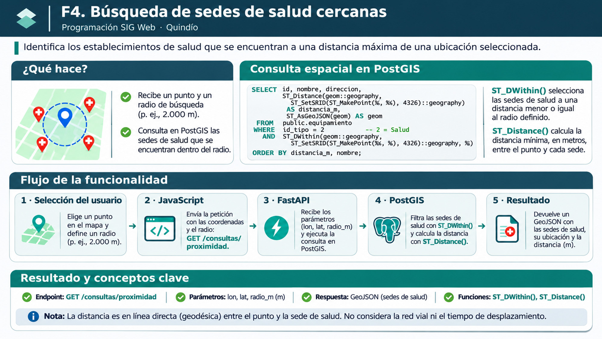

# F4 · Proximidad a sedes de salud

[← F3: identificación espacial](f3-identificacion.md) · [Menú F1–F5](index.md) · [Siguiente: F5](f5-equipamientos.md)

**Pregunta:** ¿qué sedes de prestadores de salud registradas en nuestra geodatabase se encuentran dentro de un radio determinado respecto a una ubicación elegida en el mapa?

**Al finalizar podrás:** diferenciar una relación topológica de una distancia, explicar por qué trabajamos con `geography` y metros, seguir el cálculo desde Leaflet hasta PostGIS e interpretar sus límites.

## Lámina de orientación



> **Lectura de la figura.** **Advertencia:** el SQL de esta lámina es esquemático y difiere de `backend/main.py` (por ejemplo, muestra `id` y otra formulación de la consulta). Para reproducir F4 utiliza el SQL completo transcrito en esta lección y el backend vigente.


## 1. De identificar un municipio a medir proximidad

En F3 preguntábamos **qué polígono cubre un punto** mediante `ST_Covers()`. F4 responde otra pregunta: **qué puntos de sedes de salud se encuentran a una distancia máxima del punto elegido**.

Esta operación es **métrica**, no topológica. El punto consultado no necesita pertenecer al mismo municipio que las sedes encontradas. La selección se hace sobre las ubicaciones registradas en `public.equipamiento`, exclusivamente aquellas con `id_tipo = 2` (Salud).

**Una distinción esencial:** «sede de prestador de salud» es la categoría representada en la base. No equivale necesariamente a hospital, urgencias, disponibilidad de atención o calidad del servicio.

## 2. Qué hace el usuario

1. Comprueba que se hayan cargado los municipios de F1.
2. Introduce un radio de búsqueda en metros (el valor inicial de la interfaz es **2.000 m**).
3. Activa **«Consultar salud cercana»** y hace clic en el mapa.
4. Observa el círculo de referencia, las sedes encontradas y la lista ordenada por distancia.
5. Finaliza el modo antes de cambiar el radio y realizar otra búsqueda.

La interfaz admite radios **mayores que 0 y de hasta 50.000 m**. Mientras el modo F4 está activo, el campo de radio permanece deshabilitado; para modificarlo es necesario finalizar y volver a activar el modo.

Al activar F4 se desactiva F3 si estaba activo y se suspenden temporalmente los popups municipales. Esto evita que un mismo clic active simultáneamente consultas distintas.

## 3. JavaScript: tres valores enviados a la API

La función vigente se llama `consultarProximidad(latlng)`. Prepara estos parámetros:

```javascript
const parametros = new URLSearchParams({
  lon: String(latlng.lng),
  lat: String(latlng.lat),
  radio_m: String(radio)
});

const respuesta = await fetch(
  "/consultas/proximidad?" + parametros,
  { headers: { Accept: "application/geo+json" } }
);
```

Ejemplo de estructura de la petición:

```text
GET /consultas/proximidad?lon=-75.70909&lat=4.53458&radio_m=10000
```

El navegador transmite **longitud, latitud y radio**. No descarga todas las sedes para calcular sus distancias en JavaScript: esa operación se realiza en PostGIS.

El frontend dibuja un círculo `L.circle(latlng, {radius: radio, ...})` como referencia visual. **El círculo no es el mecanismo que selecciona las sedes**: el filtro real se ejecuta en la base de datos.

## 4. FastAPI: validación de las entradas

El endpoint implementado es:

```python
@app.get("/consultas/proximidad")
def consultar_proximidad(
    lon: float = Query(..., ge=-180, le=180),
    lat: float = Query(..., ge=-90, le=90),
    radio_m: float = Query(2000, gt=0, le=50000)
):
```

- `lon` y `lat` son obligatorios y se comprueban con los intervalos geográficos generales.
- `radio_m` es opcional para la API; si se omite, toma **2.000 m**.
- Un radio nulo, negativo o superior a **50.000 m** produce **HTTP 422**.
- Un error de conexión o consulta detectado por Psycopg se comunica como **HTTP 503**.

Una coordenada válida dentro de esos intervalos **no garantiza que esté dentro del Quindío**.

## 5. PostGIS: construir el punto y filtrar las sedes

Consulta SQL del [backend vigente](../../../backend/main.py):

```sql
WITH punto AS (
    SELECT ST_SetSRID(
        ST_MakePoint(%s, %s), 4326
    )::geography AS ubicacion
)
SELECT
    e.id_equipamiento,
    e.nombre,
    e.codigo_fuente,
    e.direccion,
    ST_AsGeoJSON(e.geom) AS geometria,
    ST_Distance(e.geom::geography, p.ubicacion)
        AS distancia_metros
FROM public.equipamiento AS e
CROSS JOIN punto AS p
WHERE e.id_tipo = 2
  AND ST_DWithin(
      e.geom::geography,
      p.ubicacion,
      %s
  )
ORDER BY distancia_metros, e.id_equipamiento;
```

### Lectura por partes

**a. Punto de consulta.** `ST_MakePoint(%s, %s)` utiliza `(lon, lat)`. `ST_SetSRID(...,4326)` asigna el sistema de referencia; no reproyecta las coordenadas. El operador `::geography` permite trabajar con distancias geográficas en metros.

**b. Categoría.** `WHERE e.id_tipo = 2` limita la búsqueda a las sedes clasificadas como Salud.

**c. Selección espacial.** `ST_DWithin(e.geom::geography, p.ubicacion, %s)` conserva las sedes cuya distancia no supera el radio solicitado. Este predicado determina **qué registros entran en el resultado**.

**d. Distancia individual.** `ST_Distance(...)` calcula la distancia para **cada sede seleccionada**. Con el tipo `geography`, PostGIS utiliza por defecto cálculos sobre el esferoide correspondiente al sistema de referencia.

**e. Orden.** `ORDER BY distancia_metros, e.id_equipamiento` ordena las sedes de menor a mayor distancia y utiliza el identificador para resolver empates.

Psycopg ejecuta la sentencia suministrando `(lon, lat, radio_m)`. Los `%s` son **marcadores de parámetros**, no parte de una consulta lista para pegar tal cual en pgAdmin.

### ¿Por qué `geography`?

La geometría `Point` se almacena en EPSG:4326, con coordenadas angulares. Si se calculara una distancia planar directamente sobre estas coordenadas, las unidades serían grados, **no metros**. Convertir los operandos a `geography` permite emplear la distancia geodésica y expresar el radio en metros.

**Distinción importante:** `ST_DWithin` selecciona por umbral; `ST_Distance` proporciona la distancia que se informa y utiliza para ordenar. Ambas funciones cumplen responsabilidades distintas.

## 6. ¿Qué información regresa?

FastAPI construye una `FeatureCollection` GeoJSON. Cada sede encontrada incluye una geometría de tipo `Point` y propiedades como:

- `id_equipamiento`, `nombre`, `codigo_fuente` y `direccion`.
- `id_tipo = 2`.
- `distancia_metros`, redondeada a dos decimales.

Si no existen sedes que satisfagan el filtro, la API devuelve una colección válida con `features: []`. **No encontrar coincidencias no equivale a un error HTTP**.

El redondeo numérico se hace al preparar la respuesta; el orden SQL procede de las distancias calculadas antes de redondear.

## 7. Leaflet: puntos, círculo y listado

El frontend realiza tres representaciones complementarias:

1. Un **círculo** de referencia alrededor del punto seleccionado.
2. **Marcadores** de las sedes recibidas, creados mediante `L.geoJSON()` y `pointToLayer`.
3. Una **lista ordenada**, cuyos registros incluyen nombre y distancia directa.

Al pulsar una sede se muestra un popup con nombre, dirección, distancia y código de la fuente. Los textos proceden de atributos recibidos, no de una consulta nueva disparada por el popup.

El código limpia los elementos de la búsqueda anterior y utiliza el contador `solicitudProximidadActual` para **ignorar respuestas antiguas** si se hace otra consulta o se abandona el modo. Este mecanismo no cancela necesariamente la petición HTTP anterior.

## 8. Verificación paso a paso

**A. Petición válida.** Con FastAPI y la base activados, consulta:

```text
http://127.0.0.1:8000/consultas/proximidad?lon=-75.70909&lat=4.53458&radio_m=10000
```

Comprueba HTTP 200, `FeatureCollection` y que los resultados son puntos con `distancia_metros`. El número de sedes depende de los datos almacenados; **no debe fijarse como resultado universal**.

**B. Navegador.** Abre F12 → Network, activa F4 y selecciona una ubicación. Comprueba que la petición incluye `lon`, `lat` y `radio_m`, que los marcadores corresponden a las entidades recibidas y que el listado está ordenado.

**C. Parámetros inválidos.** `radio_m=-10` o `radio_m=60000` deben dar HTTP 422. El radio omitido debe adoptar el valor predeterminado de 2.000 m.

**D. Sin resultados.** Busca una combinación punto/radio que no tenga sedes cargadas. El resultado esperado es `features: []` y un mensaje de ausencia de registros, sin inventar establecimientos.

**E. Contraste SQL.** En pgAdmin sustituye los valores por las coordenadas **exactas** capturadas en Network, sin redondearlas:

```sql
WITH punto AS (
  SELECT ST_SetSRID(ST_MakePoint(-75.70909, 4.53458),4326)::geography AS ubicacion
)
SELECT e.id_equipamiento,
       ST_Distance(e.geom::geography, p.ubicacion) AS distancia_metros
FROM public.equipamiento e
CROSS JOIN punto p
WHERE e.id_tipo = 2
  AND ST_DWithin(e.geom::geography, p.ubicacion, 10000)
ORDER BY distancia_metros, e.id_equipamiento;
```

Si se consulta la misma base y los mismos parámetros, deben coincidir los identificadores y el orden de los resultados de la API.

**F. Propiedad del radio.** Para un mismo punto y una base sin modificaciones, aumentar el radio no debe reducir el **conjunto de sedes identificadas**. Es una comprobación útil del filtro espacial.

## 9. Interpretación científica y límites

- **Distancia geodésica directa no es distancia vial**, ni tiempo de desplazamiento, ni accesibilidad efectiva.
- El radio delimita una búsqueda geométrica respecto al **punto representativo almacenado** para cada sede. No verifica entradas, cobertura del servicio, horarios o capacidad de atención.
- El número de sedes encontradas depende de la completitud y actualidad de los registros cargados. No debe interpretarse como disponibilidad sanitaria real.
- El círculo de Leaflet es un apoyo gráfico; no se debe utilizar como comprobación exacta del algoritmo espacial de PostGIS.
- Dos sedes próximas según `geography` pueden estar separadas por barreras físicas o tener condiciones de acceso muy diferentes.
- La precisión de dos decimales en el resultado no certifica una exactitud posicional de centímetros.

## 10. Comprueba lo aprendido

¿Por qué F4 usa `ST_DWithin` en lugar de `ST_Covers`? ¿Qué diferencia existe entre **seleccionar** las sedes y **calcular** la distancia de cada una? ¿Podría una sede cercana, en línea directa, ser difícil de alcanzar por carretera?

Contrasta las respuestas con el endpoint y las geometrías registradas.

## 11. Código y continuidad

**Código ejecutable vigente:** [frontend/app.js](../../../frontend/app.js) · [backend/main.py](../../../backend/main.py) · [frontend/index.html](../../../frontend/index.html).

**Guía histórica de desarrollo:** [Etapa 07 — F4](../../etapa-07-f4-proximidad-salud.md). Se conserva para estudiar la evolución del ejercicio, pero esta lección explica el funcionamiento actual.

[← F3](f3-identificacion.md) · [Menú F1–F5](index.md) · [Continuar con F5 →](f5-equipamientos.md)
