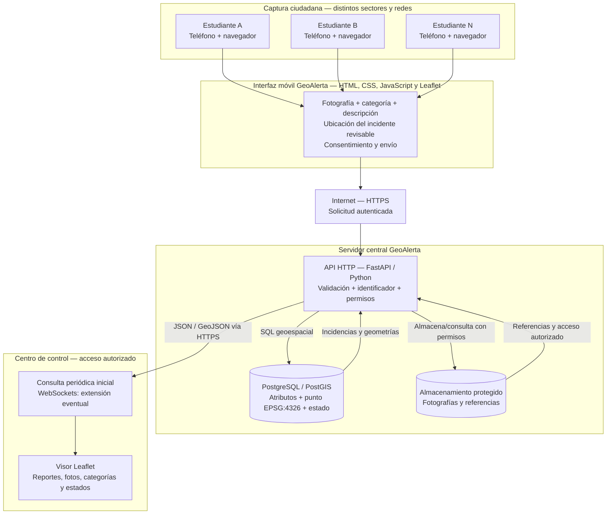

# Arquitectura funcional del piloto — GeoAlerta

> **Estado:** arquitectura conceptual de referencia, no implementación desplegada. 21 de octubre de 2026.

## Figura 01. Arquitectura funcional del piloto

**Lectura funcional.** Estudiantes en distintos sectores envían incidencias desde teléfonos y redes independientes. La aplicación solicita permiso de geolocalización, permite corregir el punto para representar el **incidente** (no necesariamente la vivienda o posición del reportante) y adjunta fotografía, categoría y descripción. El servidor valida las solicitudes, registra el punto y los metadatos en PostgreSQL/PostGIS y administra las fotografías en almacenamiento protegido. El centro de control consulta mediante API las incidencias autorizadas y las muestra en un mapa Leaflet.

## Componentes y responsabilidades

| Componente | Responsabilidad | Estado del piloto |
|---|---|---|
| Aplicación móvil web | Capturar foto, descripción, categoría, punto geográfico y autorización de envío | Por implementar |
| Red HTTPS | Proteger transporte y habilitar geolocalización en móviles | Por desplegar |
| API FastAPI | Validación de entrada, autenticación, creación/consulta, permisos y acuse de recepción | Por implementar |
| PostgreSQL/PostGIS | Persistencia de geometrías puntuales EPSG:4326, atributos y estados | Por implementar |
| Almacenamiento de fotos | Archivos con acceso controlado y referencias almacenadas en BD | Por implementar |
| Centro de control Leaflet | Visualizar y filtrar incidencias con sus fotos y estados | Por implementar |
| Actualización automática | Consultas periódicas iniciales; latencia a medir | Por implementar |

## Secuencia mínima de validación

1. Un estudiante, fuera o dentro del entorno de referencia, abre la interfaz a través de HTTPS y autoriza voluntariamente la geolocalización.
2. Registra una incidencia de prueba con fotografía, categoría, descripción y punto corregible en el mapa.
3. La API verifica la solicitud y crea un identificador; almacena los metadatos y geometría en PostGIS y gestiona la foto con permisos.
4. El centro de control obtiene la información mediante HTTPS y representa el reporte sin intervención manual sobre archivos.
5. Se repite desde varios dispositivos y redes para comprobar recepción, integridad espacial, acceso autorizado y latencia de actualización.

## Reglas de diseño que no deben perderse

- **No confundir localización del dispositivo con la del incidente.** El punto se debe poder revisar y corregir.
- **No divulgar viviendas ni coordenadas sensibles.** Las pruebas son voluntarias; no exigir reportar desde el domicilio.
- **No exponer secretos o acceso directo a la base de datos en el navegador.**
- **No interpretar la recepción como verificación institucional.** Distinguir reportes de prueba, reportes por verificar y estados posteriores.
- **No declarar «tiempo real» sin medición.** El piloto utilizará sondeo periódico inicialmente; WebSockets puede añadirse más adelante.
- **No ofrecer atención de emergencias.** Los incidentes de peligro inmediato deben utilizar canales oficiales.
- **No publicar imágenes identificables sin un tratamiento adecuado de privacidad, conservación y eliminación.**

## Delimitación docente

Este diagrama describe exclusivamente el **piloto GeoAlerta**, dentro de `proyectos/geoalerta/`. No modifica el geovisor municipal ni otros ejercicios del repositorio principal.

**Referencia:** [README del proyecto](../README.md).
